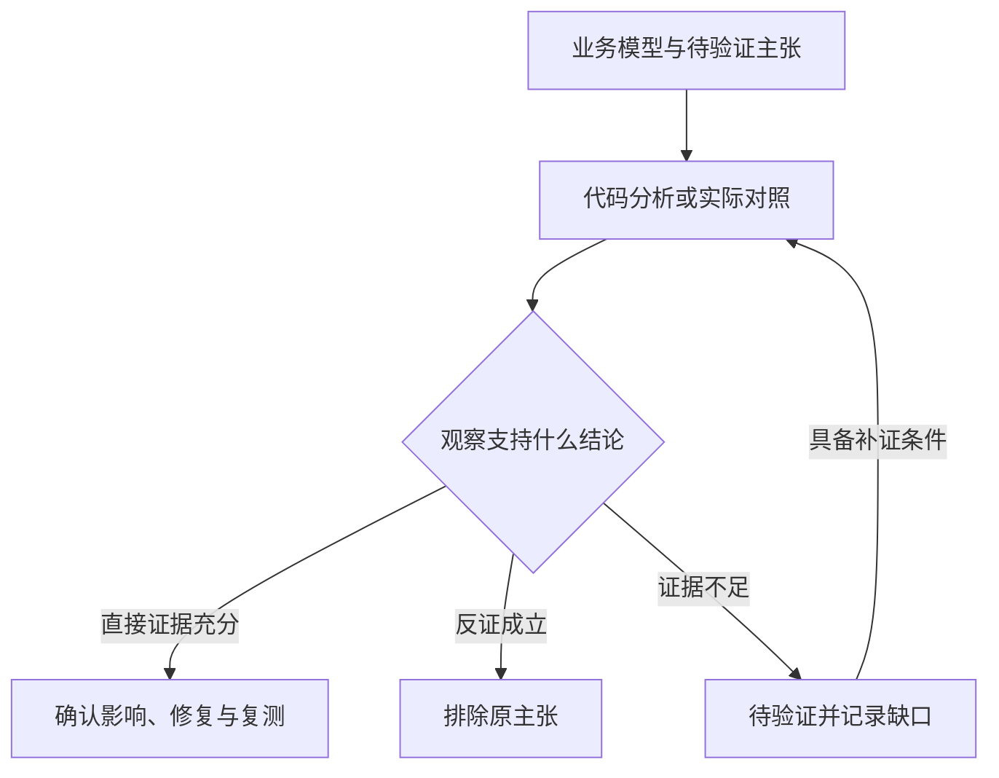

# MiniApp Audit Skills

[](https://github.com/bx33661/miniapp-audit-skills/actions/workflows/validate.yml)
[](./LICENSE)

面向 AI Agent 的微信小程序安全审计技能集。将业务建模、代码分析、请求验证和证据报告组织为可组合的工作流，支持从运行目标、源码或解包材料、已有证据开始。

Agent 负责理解业务、设计对照和判断影响；脚本负责材料提取、实际请求发送与产物校验。发现结论保留可追溯证据，覆盖缺口和受阻原因一并交付。

[快速开始](#快速开始) · [使用示例](#使用示例) · [技能目录](#技能目录) · [请求重放](#请求重放) · [验证与贡献](#验证与贡献)

## 快速开始

通过 [Skills CLI](https://github.com/vercel-labs/skills) 安装到支持 [Agent Skills](https://agentskills.io/) 的客户端；该命令需要 Node.js 与 npx：

```bash
npx skills add bx33661/miniapp-audit-skills
```

安装时选择全部六个技能，并保留原目录名。技能之间通过相对路径共享参考文档与输出契约。

安装后，在 Agent 中描述任务或明确指定技能：

```text
使用 miniapp-audit 规划这次微信小程序审计。根据我提供的目标、授权账号和现有材料选择入口，
优先检查登录身份、对象归属和关键业务状态，并记录证据与覆盖缺口。
```

<details>
<summary>Claude Code 插件市场与手动安装</summary>

Claude Code 中执行：

```text
/plugin marketplace add bx33661/miniapp-audit-skills
/plugin install miniapp-audit@miniapp-audit-skills
```

手动安装时，将本仓库 `skills/` 下的六个 `miniapp-*` 目录复制到客户端的技能根目录。例如，项目级 Claude Code 使用 `.claude/skills/`，支持相应目录约定的客户端可使用 `.agents/skills/`。六个目录保持同级，不额外包一层命名空间。

技能以 Agent 的权限运行；安装前请审阅技能入口、引用文档与脚本。客户端的技能加载方式与可用工具以实际版本为准。

</details>

## 使用示例

### 只有运行中的小程序和测试账号

```text
使用 miniapp-dynamic 抓取这个小程序的业务请求。我有授权测试账号 A/B，没有源码。
先建立各自的正常业务基线，再验证跨账号对象访问，保存实际请求、响应和阻塞原因。
```

### 已有源码或解包目录

```text
使用 miniapp-static-audit 审查 ./miniapp-source 中的登录、订单和云函数调用。
追踪客户端可控输入、实际安全控制与对象归属，把直接证据和待验证假设分别列出。
```

### 已有抓包与审计证据

```text
使用 miniapp-report 整理 ./evidence 中的审计材料。
核对发现与证据引用，区分已确认、待验证和已排除，给出修复建议、复测标准与覆盖限制。
```

## 技能目录

| 技能 | 何时使用 | 主要产出 |
|---|---|---|
| [miniapp-audit](./skills/miniapp-audit/SKILL.md) | 规划完整审计、选择入口或复核质量 | 范围、会话与覆盖记录 |
| [miniapp-recon](./skills/miniapp-recon/SKILL.md) | 获取或核实源码、wxapkg、主包、分包与插件 | 材料清单、来源与完整性限制 |
| [miniapp-threat-model](./skills/miniapp-threat-model/SKILL.md) | 梳理角色、资产、状态与信任边界 | 滥用用例、有优先级的验证假设 |
| [miniapp-static-audit](./skills/miniapp-static-audit/SKILL.md) | 审查代码、配置、输入路径与实际控制 | 攻击面、直接证据与测试思路 |
| [miniapp-dynamic](./skills/miniapp-dynamic/SKILL.md) | 从流量发现接口，或验证已有请求与假设 | 捕获、重放、身份对照与实验结果 |
| [miniapp-report](./skills/miniapp-report/SKILL.md) | 整理证据、评级、交付报告与复测标准 | 归一化发现、证据索引与报告 |

六个技能按任务组合，专项任务可以独立执行。解包用于补充所需材料；运行测试可以直接从目标与授权账号开始。

长任务、跨会话或并行 Agent 可选用 blackboard 作为外置证据台账；六个技能不依赖它，映射见 `skills/miniapp-audit/references/blackboard.md`。

## 审计方法

围绕具体资产、身份与预期控制提出可证伪的主张，再选择代码分析或实际对照获取证据。



动态实验先建立正常业务基线，再改变最少业务变量，用实际资源、权限或状态判断结果。会话过期、签名失败和响应截断分别记录；HTTP 状态与成功重放只是实验观察的一部分。

平台判断按疑点加载：[运行结构](./skills/miniapp-audit/references/runtime-model.md)解释页面、组件、分包、会话与请求层；[平台案例](./skills/miniapp-audit/references/platform-cases.md)覆盖自建登录、云身份、多通道会话、原生富文本、构建入口与开发者工具权限。

## 产出与证据

产物按实际执行阶段生成。典型证据目录如下：

```text
evidence/
├── report.md                    # 报告阶段整理的结论、修复与复测标准
├── findings.json                # 归一化发现
├── evidence.json                # 稳定证据编号与来源索引
├── dynamic-test-results.json    # 动态请求与安全实验记录
├── replay-run.json              # 内置执行器的实际执行回执
└── captures/                    # 脱敏请求、响应与输入制品
```

发现使用稳定 `F-001` 编号，证据使用 `EV-001` 编号。最终发现状态为 `confirmed`、`needs_validation`、`rejected`；只有已确认发现分配严重性，其余记录保留验证优先级与缺失事实。

E0/E1 表示线索或待验证路径；确认需要 E2/E3 直接证据，并满足资产、失效边界、复现与影响等确认条件。证据强度取决于证明的事实。字段以 [发现契约](./skills/miniapp-report/assets/finding.schema.json)、[证据契约](./skills/miniapp-report/assets/evidence.schema.json)和[证据标准](./skills/miniapp-report/references/evidence-standard.md)为准。

## 请求重放

内置执行器支持 HTTP/1.1、HTTP/HTTPS、显式 HTTP 代理与 HTTPS CONNECT、受信 CA、独立账号 CookieJar，以及重复参数、multipart 和二进制正文保真。

需要 Python 3.10+。在仓库根目录的 Python 虚拟环境中安装依赖，并按[双账号计划示例](./skills/miniapp-dynamic/assets/replay-plan-example.json)准备真实授权目标与账号来源：

```bash
python3 -m pip install -r skills/miniapp-dynamic/requirements.txt
python3 skills/miniapp-dynamic/scripts/replay.py --plan /path/to/plan.json --output-dir /path/to/new-evidence
python3 scripts/validate_outputs.py --evidence-dir /path/to/new-evidence --verify-artifacts
```

计划明确目标 origins、方法、请求限额与超时，凭证从指定环境变量读取。每次实际尝试保留脱敏制品与 SHA256；未发送、传输失败和完整响应分别记录。输出目录必须是新路径。

内置 HMAC-SHA256 与 AES-GCM 适配仅支持文档规定的格式；其他协议需要已核实的工具能力或记录受阻。执行器产出请求观察，漏洞结论由分析者结合业务对照整理。计划字段、签名格式、会话失效与退出码见[执行指引](./skills/miniapp-dynamic/references/execution.md)。

## 验证与贡献

在仓库根目录的 Python 虚拟环境中运行：

```bash
python3 -m pip install -r requirements-dev.txt
python3 scripts/validate_skills.py --strict
python3 scripts/check_links.py
python3 -m unittest discover -s evals -p 'test_*.py'
python3 evals/run_scenarios.py --output-dir /path/to/new-scenario-output
```

CI 检查技能格式、相对链接与行为回归。本地场景使用真实 HTTP/HTTPS 服务和代理，独立核验资源归属、账号隔离、签名、加密、字节保真与证据完整性；每次评测使用新的输出目录。

场景运行、结果判定与独立 Agent 任务入口见[评测说明](./evals/README.md)。这些结果限定于实际运行的场景；真实微信、Reqable、Nightly 或 wechatide 的兼容性需要现场核实，模型审计效果需要独立评测。

- [贡献指南](./CONTRIBUTING.md)：技能结构、文档与提交检查。
- [设计约定](./docs/design.md)：阶段组合、输出契约与维护原则。
- [更新记录](./CHANGELOG.md)：能力变化与实际验证范围。

## 授权与数据处理

仅测试获得授权的目标与账号，沿用有效范围与操作约定。生产环境默认只读，状态变更需要明确许可、受控环境与回滚方案；不执行真实资金操作或未经授权的删除与权限变更。共享前复核脱敏结果，并按约定保留或删除原始材料。详见[安全政策](./SECURITY.md)。

## License

[MIT](./LICENSE)
